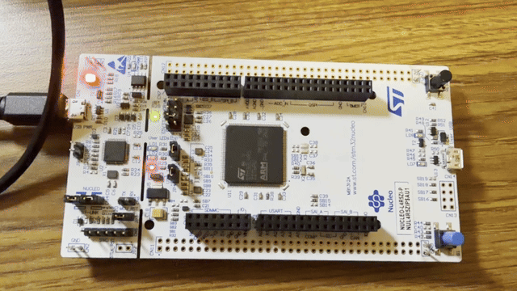
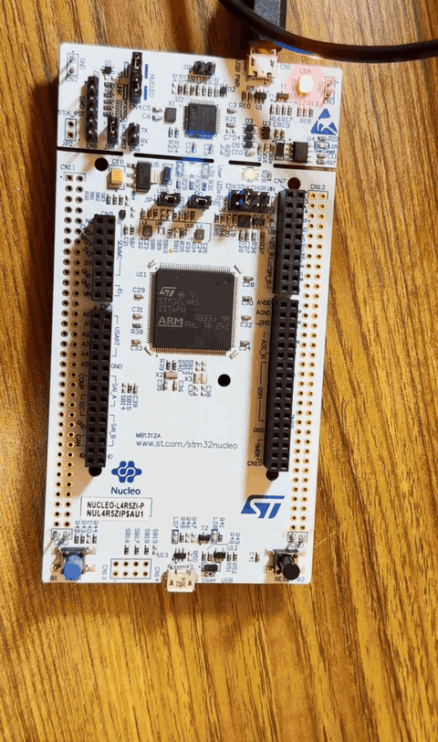

# E186 Lab 2

## 2.

### 2a.

An external interrupt lets the microcontroller respond to an external event (like a button press) without having to essentially continuously checking for it. When the configured event occurs and the interrupt is enabled, the processor pauses its current execution and runs an ISR. The ISR handles the event, then the processor resumes where it left off in the main program. And then the ISR must clear the EXTI pending flag to acknowledge the event. Otherwise, the same interrupt can repeatedly trigger the ISR.

### 2b.

## 3.

### 3a.

A timer interrupt similarly lets the microcontroller perform a task at regular intervals without continuously checking the time. How it works is essentially a hardware counter counts clock ticks at a rate determined by the timer clock and a prescaler. When the counter reaches its configured limit it generates an update event that requests an interrupt. Then the processor pauses its current execution, runs the ISR, and then resumes. Unlike an external interrupt, which responds to an outside event, a timer interrupt responds to the timer’s count

### 3b.

Taking the 16 MHz HSI16 clock specified in the slides, and then choosing a prescaler of 15,999, we get counter freq of:

16,000,000 / (15,999 + 1) = 1,000 Hz

I then chose an auto-reload value of 999 so an interrupt occurs every 1,000 ticks:

1,000 / (999 + 1) = 1 Hz

This generates one interrupt per second as we wanted, allowing the LED to change color every second.

### 3c.

## 4.

### 4a.

